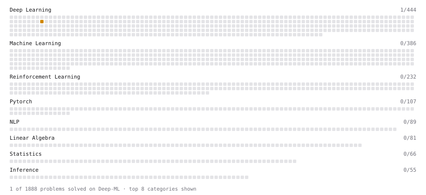

# Deep-ML

My machine learning practice from [Deep-ML](https://www.deep-ml.com). Every solution here was written by hand.

**2** solved · 2 problems · 0 labs · 0 math

[**Browse the interactive portfolio**](https://jackjyzhang.github.io/deep-ml/) to replay this filling in over time.

## Problems

| | Difficulty | Solved | |
| --- | --- | --- | --- |
| [Rotary Positional Embeddings (RoPE)](https://www.deep-ml.com/problems/381) | medium | 2026-11-03 | [solution](problems/0381-rotary-positional-embeddings-rope) |
| [Top-p (Nucleus) Sampling](https://www.deep-ml.com/problems/383) | medium | 2026-11-03 | [solution](problems/0383-top-p-nucleus-sampling) |

---

_This file is regenerated by Deep-ML on every push._
